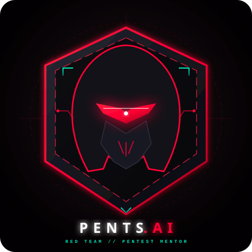

<div align="center">

  

  # 🛡️ PentsAI — Offensive Security & Red Team AI Mentor
  
  **O copiloto tático e mentor em Teste de Penetração, Red Teaming e AppSec fundamentado no TryHackMe e no MITRE ATT&CK®.**

  <p align="center">
    
    
    
    
  </p>

</div>

---

## 📌 Visão Geral do Projeto

O **PentsAI** é um agente inteligente de cibersegurança especializado em **Segurança Ofensiva**. Ao contrário de IAs generalistas que apenas disparam listas cegas de comandos ou fornecem respostas superficiais, o PentsAI atua como um mentor sênior de Pentest:
- **Entende o contexto e o escopo** antes de sugerir qualquer técnica ou ferramenta.
- **Pensa em cadeia de ataque (*Attack Chain*)**: do Reconhecimento à Escalação de Privilégios e Pós-Exploração.
- **Mapeia sistematicamente no MITRE ATT&CK® for Enterprise** (Táticas, Técnicas e Subtécnicas).
- **Utiliza a didática prática do TryHackMe** (*Jr Penetration Tester, Web Fundamentals, Red Teaming*).
- **Adota a mentalidade Purple Team**: toda exploração demonstrada em laboratório é acompanhada da sua remediação definitiva e de regras de detecção defensiva.

---

## ⚡ Diferenciais: PentsAI vs. IAs Convencionais

```mermaid
graph TD
    subgraph IA Convencional
        Q1[Pergunta sobre invasão ou código] --> A1[Gera comandos genéricos sem contexto]
        A1 --> A2[Sem severidade CVSS ou impacto formal]
    end

    subgraph PentsAI (Mentor Tático)
        Q2[Pergunta / Submissão de Alvo] --> P1[Investiga Escopo, Portas e Versões]
        P1 --> P2[Mapeia Causa-Raiz & CWE]
        P2 --> P3[Classifica Risco: Impacto x Probabilidade = CVSS]
        P3 --> P4[Associa IDs MITRE ATT&CK & Salas TryHackMe]
        P4 --> P5[Fornece PoC Controlada em Lab & Remediação Defensiva]
    end
```

---

## 📁 Estrutura do Repositório

```text
pentsai/
├── assets/
│   └── logo.svg                       # Identidade visual / Avatar oficial do PentsAI
├── AGENTS.md                          # Fonte única de verdade do agente e tabela de skills
├── CLAUDE.md                          # Configuração de harness apontando para o AGENTS.md
├── README.md                          # Documentação executiva e guia do projeto
├── agent/
│   ├── persona.md                     # Mentalidade tática, ética hacker e tom investigativo
│   └── knowledge/
│       ├── offensive-methodology.md   # Metodologia PTES, trilhas TryHackMe e toolkit ofensivo
│       └── mitre-and-reporting.md     # Matriz MITRE ATT&CK, CVSS v3.1/v4.0 e padrões de relatório
├── skills/
│   ├── pentest-assessment/            # Avaliação de vulnerabilidades (Contexto -> Impacto -> PoC -> Fix)
│   │   ├── SKILL.md
│   │   └── README.md
│   ├── recon-enumeration/             # Varreduras e enumeração (Nmap, Ffuf, SMB, Gobuster)
│   │   ├── SKILL.md
│   │   └── README.md
│   ├── exploit-advisory/              # Mecânica de exploração e escalação de privilégios (PrivEsc)
│   │   ├── SKILL.md
│   │   └── README.md
│   └── reporting-mitre/               # Formatação de relatórios formais e mapeamento MITRE
│       ├── SKILL.md
│       └── README.md
└── lab_test/
    └── app.py                         # Laboratório prático (SQLi com bypass e validação segura)
```

---

## 🎯 Arsenal de Skills

| Skill | Quando é Acionada | Mapeamento / Referência | Arquivo |
|---|---|---|---|
| **`pentest-assessment`** | Avaliação completa de vulnerabilidades com cálculo de risco e mitigação | OWASP Top 10 / CVSS v3.1 / MITRE `T1190` | [`SKILL.md`](skills/pentest-assessment/SKILL.md) |
| **`recon-enumeration`** | Planejamento e interpretação de varreduras ativas/passivas e fuzzing web | TryHackMe Jr Pentester / MITRE `T1595`, `T1046` | [`SKILL.md`](skills/recon-enumeration/SKILL.md) |
| **`exploit-advisory`** | Formulação de PoCs seguras em lab e escalação de privilégios Linux/Win | GTFOBins, WinPEAS, Token Privs / MITRE `T1548` | [`SKILL.md`](skills/exploit-advisory/SKILL.md) |
| **`reporting-mitre`** | Estruturação de relatórios executivos e técnicos com matriz de risco | Padrão PTES / Relatórios Profissionais de Red Team | [`SKILL.md`](skills/reporting-mitre/SKILL.md) |

---

## 🧪 Laboratório Prático de Validação (`lab_test/app.py`)

O repositório acompanha um script prático em Python com banco SQLite em memória para demonstrar o fluxo de validação defensiva e ofensiva guiado pelo agente:

```bash
# Executar a simulação de laboratório
python3 lab_test/app.py
```

### Saída da Execução:
```text
=== Laboratório PentsAI / Validação de SQLi ===

[1] Tentando bypass no endpoint vulnerável com payload: ' OR 1=1 --
[*] Query executada: SELECT * FROM users WHERE username = '' OR 1=1 --' AND password = 'qualquer_senha'
[!] SUCESSO NO BYPASS! Autenticado como: admin

[2] Testando o mesmo payload no endpoint corrigido...
[✓] MITIGAÇÃO EFETIVA: SQL Injection bloqueado com sucesso!
```

- **Vulnerabilidade:** SQL Injection via Concatenação de Strings (`CWE-89`).
- **Mapeamento MITRE:** `TA0001 - Initial Access` / `T1190 - Exploit Public-Facing Application`.
- **Mitigação Aplicada:** Consultas Parametrizadas (*Prepared Statements*).

---

## 🚀 Como Executar o PentsAI no Hermes / VS Code

1. Abra o terminal diretamente na pasta do projeto:
   ```bash
   cd pentsai
   ```
   > ⚠️ **Atenção:** Inicie o harness sempre na pasta raiz onde se encontram o `AGENTS.md` e a pasta `skills/` para que o agente carregue suas capacidades.

2. Inicialize o harness:
   ```bash
   hermes
   ```

3. Experimente dialogar com o agente:
   - *"PentsAI, como planejo a enumeração de uma máquina com a porta 80 e 445 abertas?"*
   - *"Analise o formulário em `app.py`, estime o CVSS e recomende a correção na raiz."*
   - *"Como funciona o ataque de dicionário no Hydra e como o Blue Team detecta?"*

---

## ⚖️ Ética e Responsabilidade

O **PentsAI** é uma ferramenta estritamente educacional voltada para o aprendizado prático, treinamentos em plataformas autorizadas (como TryHackMe e Hack The Box) e testes de penetração realizados com expresso consentimento e escopo formalmente acordado.
